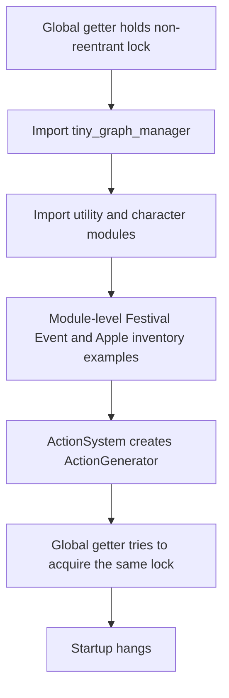

# Issue #719 Graph Initialization Implementation Plan

> **For agentic workers:** REQUIRED SUB-SKILL: Use superpowers:subagent-driven-development or superpowers:executing-plans to implement this plan task-by-task. Steps use checkbox (`- [ ]`) syntax for tracking. Sequential execution in this session is recommended; no delegation is approved by this document.

**Goal:** Resolve the GraphManager initialization deadlock completely within #719's scope, preserving one fully initialized world and explicit dependency ownership.

**Architecture:** Remove world-object construction from imports. Keep `tiny_globals` as the application access point and preserve `GraphManager()` singleton compatibility, with coordinated, bounded initialization and explicit injection into dependent systems. Initialize the graph before composing its consumers; publish it only after successful construction.

**Tech Stack:** Python 3.12, standard-library threading/subprocess/unittest, existing NetworkX WorldState and runtime classes; no new runtime dependencies.

**Spec:** [Issue #719](https://github.com/dhar174/tiny_village/issues/719), its acceptance criteria below, and the user's instruction: “Don't start implementation until the plan has been reviewed and approved.”

**Status:** Approved by the user on 2026-10-14; sequential implementation authorized. Completion evidence is tracked in TASK003 and the execution ledger.

## Global Constraints

- “Remove import-time world construction and explicitly wire graph ownership.”
- “Reproduce and resolve the named-target initialization hang; do not merely swap locks without checking recursive initialization.”
- “Fresh-process import-order and singleton checks complete within a bounded timeout and return the same graph instance.”
- Preserve the #718 fallback repair and optional-dependency behavior.
- Keep runtime modules at their existing root-level paths. No dependency/framework migration, new global container, or general graph rewrite.
- Use the existing checkout and development environment. Do not create a worktree or install heavy model dependencies for this task.
- Tests target the issue's specified import, ownership, and singleton behavior. No repo-wide lint, formatting, type-checking, or unrelated test cleanup.
- No implementation before plan approval. No merge, issue closure, or human phase approval inferred from that approval.

## Review Focus

1. Different cold import orders: definitions load without constructing a graph, event, food item, or action system as sample world state. Task 1 tests eight orders.
2. Simultaneous first access, including direct constructors: callers receive one ready graph, with one WorldState initialization. Task 2 tests mixed access from eight threads over ten rounds.
3. Recursive calls from the initializing thread: fail promptly with a clear RuntimeError rather than hanging or returning a partial graph. Task 2 tests getter-first and constructor-first recursion.
4. Construction failure and retry: both singleton references and initialization guards recover; the next normal call succeeds. Task 2 injects failure at the construction boundary.
5. Explicit injection, setter, and reset: dependencies stay with the supplied owner, and test reset never imports the graph or accidentally creates a world. Tasks 2–4 test these contracts.

## Evidence and root cause

Reviewed main is `610b4f871694a380f3fedfd48664c188a169cbee`, containing merged PR #706. The current local revision `fd4c04ed3d833a59136930f05c12c147b3b090ea` has the identical Git tree `20582ada162a475256d22be5d051dda7544b508b`; the inspection and read-only probes therefore cover that main content.

Two fresh subprocesses were run during planning with a 10-second fatal traceback timer and 15-second parent timeout. Both timed out: cold `get_global_graph_manager()` and the existing `test_action_named_target_resolution.py` suite. Planning logs are outside the checkout under `/workspace/scratch/issue-719-planning/`. These are baseline failures, not successful verification of a repair.



Relevant inspected locations:

- `tiny_globals.py:194–286`: duplicated initialization, imports under the lock, and reset importing under the lock.
- `tiny_characters.py:1063–1095`: object-valued `example_criteria_i` and `example_criteria_j`. Repository search finds no consumers of these two names outside their definitions.
- `tiny_event_handler.py:53`, `actions.py:1226–1285`: Event defaults to ActionSystem, whose generator defaults to the global graph.
- `tiny_graph_manager.py:714–801`: class singleton allocation occurs before its initialization completes and has no construction synchronization.
- `tiny_items.py:165`, FoodItem/Door construction, and `tiny_locations.py:83`: injected action systems are discarded or their graph is not forwarded into nested actions.
- `tiny_characters.py:2137–2225`: default action-system resolution precedes graph resolution; generated character actions omit the graph.
- `tiny_gameplay_controller.py:1784–1805` and `tiny_strategy_manager.py:122`: strategy initialization currently resolves a global graph before the controller resolves its supplied graph.

Changing Lock to RLock alone could turn the deadlock into recursive construction. Returning None or an allocated-but-uninitialized graph would hide the defect. Neither satisfies this plan.

## Scope and file map

| File | Planned responsibility |
| --- | --- |
| `tiny_characters.py` | Move object-valued examples to an explicit factory; resolve and forward the character's graph/action system |
| `tiny_globals.py` | One initialization path; imports outside the global lock; recursion guard; consistent set/reset lifecycle |
| `tiny_graph_manager.py` | Serialize the complete singleton construction; roll back failed construction; private coordinated lifecycle helpers |
| `tiny_items.py` | Preserve supplied action systems through ItemObject, FoodItem, Door, and their generated actions |
| `tiny_locations.py` | Forward the supplied action system's graph to generated location actions |
| `tiny_event_handler.py` | Preserve an explicitly supplied action system, using an explicit None check |
| `tiny_strategy_manager.py` | Add a backward-compatible optional graph parameter and pass it into GOAPPlanner |
| `tiny_gameplay_controller.py` | Resolve graph before strategy composition; pass it into normal and recovery construction |
| `tests/test_graph_initialization.py` (new) | Bounded subprocess tests for imports, construction, concurrency, failure, and lifecycle |
| `tests/test_graph_ownership.py` (new) | Focused injection and real graph-backed action checks |
| `docs/testing/issue-719-graph-initialization-validation.md` (new, after execution) | Before/after commands, traces, actual counts, and remaining limitations |
| Existing graph reference/connectivity docs, CHANGELOG, Memory Bank | Update only initialization contracts and this task's status |

`actions.py` already accepts and forwards an explicit graph in Action, ActionGenerator, ActionSystem, and ActionTemplate. Preserve those interfaces; change that file only if the focused ownership tests identify an actual forwarding omission.

Excluded: cache permissions/model initialization (#720), utility Goal interface/fixture repairs (#774), minimal integration fixture repairs (#773), new named-target semantics (#602), broader social-state consolidation (#222), gameplay balancing, UI/aesthetic redesign, and persistence changes. Constructor edits above are restricted to ownership and initialization order. Discoveries requiring additional behavior changes must be reported and scoped separately before implementation.

## Proposed contracts for approval

- Keep `get_global_graph_manager()` and `initialize_global_graph_manager()` lazy and idempotent, returning the same ready graph. The getter delegates its cold path to the initializer.
- Keep `GraphManager()` singleton behavior for existing callers. Use a small private `_GraphManagerSingleton(type)` construction gate around the complete `__new__`/`__init__` call, rather than locking allocation alone. Preserve existing constructor overrides; do not redesign subclass semantics or GOAP algorithms.
- Use thread-local construction/initialization markers. Same-thread recursive initialization raises `RuntimeError` containing `Recursive GraphManager initialization` before any lock it would acquire again. Check both provider initialization and class construction before taking the global lock.
- Import `tiny_graph_manager` before acquiring the global initialization lock. Keep the consistent lock order **global lifecycle lock → class construction lock** where both are needed. Constructor callbacks must fail before reversing that order.
- Expose no partial graph through public calls. Clear failed candidates and markers in finally/exception paths and retain the original exception cause. Preserve ImportError context; do not convert unrelated construction errors into missing-dependency warnings.
- `has_global_graph_manager()` reports False when the constructing thread queries status before publication; it must not wait on that thread's own lock. Other callers receive a synchronized readiness result.
- Keep `set_global_graph_manager(graph_manager)` and test-only `reset_global_graph_manager()` signatures. Setting a ready real GraphManager aligns the class/global references; retain controlled duck-typed injection compatibility. Setting None retains its current “clear provider reference” behavior. Reset clears both references, inspecting an already-loaded module instead of importing it.
- Reset/replacement is supported between tests or at a quiescent boundary, not as a live-world hot-swap mechanism. Existing objects may still hold an old graph after reset; callers must discard those objects. Concurrent ordinary first access is supported and tested.
- Move the two unused object-valued example globals into `build_example_world_criteria(graph_manager: "GraphManager") -> dict[str, list[dict]]`. Return keys `example_criteria_i` and `example_criteria_j`, preserving their Festival/Apple contents; create them only when explicitly called with an owner. Existing data-only criteria remain unchanged. This changes the two sample globals' access pattern and is an explicit approval decision.
- Extend StrategyManager as `__init__(self, use_llm=False, model_name=None, graph_manager=None)`, preserving existing positional arguments. An explicit graph always wins; otherwise retain legacy lazy global access.

## Ordered implementation tasks — after approval only

### Task 1: Remove import-time sample world construction

**Files:** Modify `tiny_characters.py`; create `tests/test_graph_initialization.py`.

**Interfaces:** Consume existing `ActionSystem(graph_manager=None)` and `Event(..., action_system=None)`. Produce the explicit `build_example_world_criteria(graph_manager)` factory; bare imports leave both graph singleton references empty.

- [x] Record approval, update to the then-current main, and establish the implementation branch in the existing checkout. Recheck this plan's call sites if main changed.
- [x] Add stdlib-only subprocess test infrastructure: execute child source with a 20-second fatal traceback timer and `subprocess.run(..., timeout=25, capture_output=True, text=True)`. Preserve stdout, stderr, exit status, and timeout reason; subprocess failures must fail the test.
- [x] Add `test_imports_do_not_construct_world` with eight fresh-process orders: globals first; graph first; characters first; utility first; GOAP first; actions then locations; items then events; strategy then controller. Assert `has_global_graph_manager()` is False and the loaded real GraphManager class has no instance after imports.
- [x] Run the new tests against the unchanged baseline and preserve the failing/hanging results.
- [x] Move only the object-valued examples into the explicit factory. Leave the factory unused during import. Audit actual top-level world construction in the modules on the traced path.
- [x] Rerun the import tests. Keep a narrow commit for this deliverable. Factory ownership assertions become required in Task 3 once the existing nested forwarding omissions are fixed.

### Task 2: Make singleton construction and lifecycle safe

**Files:** Modify `tiny_globals.py`, `tiny_graph_manager.py`; extend `tests/test_graph_initialization.py`.

**Interfaces:** Preserve public initializer/getter/setter/reset signatures. Add private class lifecycle helpers `_is_initializing_on_current_thread() -> bool`, `_reset_singleton() -> None`, and `_adopt_singleton(instance: "GraphManager") -> None`; protect them with the class construction gate. Helpers must not import the graph or acquire the global lock.

- [x] Add failing tests for cold getter and explicit initialization, constructor/getter identity, and one-time WorldState creation.
- [x] Add `test_concurrent_mixed_first_access`: eight barrier-synchronized workers mix getter, initializer, and direct constructor calls; assert one object/UUID, one WorldState initialization, `G is world_state.graph`, and initialized analytics/social model. Repeat ten rounds with quiescent reset. Bound joins and capture worker exceptions.
- [x] Add recursion tests for getter-first and direct-constructor-first access using a controlled constructor callback. Assert prompt RuntimeError, no published graph, released locks, and successful retry after removing the callback.
- [x] Add failure/retry tests by injecting one constructor failure while retaining the real constructor for successful calls. Assert no partial singleton survives, original error context is retained, and a subsequent call builds one ready graph. Test waiting callers' eventual progress without requiring every caller to receive the same failed attempt.
- [x] Add reset/setter/status tests: reset before graph import leaves that module unimported; reset after success creates a different next graph; reinjecting a previously ready real instance keeps getter and constructor identity consistent; recursive reset/replacement is rejected promptly; querying readiness from inside construction returns False without hanging.
- [x] Consolidate initialization, move imports outside the provider lock, add pre-lock recursion checks, serialize complete class construction, and implement coordinated rollback/set/reset without widening exception catches.
- [x] Run lifecycle/concurrency tests and `python -m unittest -v test_core_global_graph_manager`. Review the lock-order and publication invariants; commit this deliverable.

### Task 3: Preserve graph ownership through nested domain objects

**Files:** Modify `tiny_characters.py`, `tiny_items.py`, `tiny_locations.py`, `tiny_event_handler.py`; create `tests/test_graph_ownership.py`. Preserve existing actions interfaces.

**Interfaces:** Consume a ready real graph and `ActionSystem(graph_manager=graph)`. The character, event, item, location, ActionGenerator, and their generated Action instances retain that owner. Constructors resolve defaults only when the corresponding argument is None.

- [x] Add failing tests that pass an explicit action system and make the global getter raise if called unexpectedly. Use real runtime Action/ActionSystem/Location/Event/item classes and an actual ready GraphManager for successful behavior.
- [x] Assert FoodItem and Door forward their action system to ItemObject; ItemObject uses it for its location; all generated item/location actions retain its graph. Exercise a valid falsy injected boundary object separately to pin explicit-None semantics.
- [x] Assert the criteria factory creates fresh Festival/Apple objects on each explicit call and uses the supplied action system/graph throughout. Importing characters must still construct none of those objects.
- [x] Resolve a Character's graph before creating its default action system; fix only the local class/module alias needed for that construction and forward the same graph into its generated actions. Exercise compatible existing real-character fixtures; do not repair unrelated character statistics, motives, or memory behavior.
- [x] Fix the identified forwarding omissions and Event's supplied-action-system selection, leaving effect values and target-resolution semantics unchanged.
- [x] Run ownership tests, the import suite, and all six existing named-target tests in a fresh bounded subprocess. Add one real graph-backed named-target case using lightweight demo characters and existing Action. Register UUID-keyed nodes on the actual WorldState graph and matching objects in its character registry, using the identifiers already passed by Action.execute. Assert the selected character changes once, a bystander stays unchanged, and its authoritative graph attribute reflects the result. Commit the ownership deliverable. Do not change canonical node-key/UUID semantics, which belong to the later action/world-state alignment tasks.

If graph key/UUID mapping or full Character construction reveals an unrelated defect, record it separately. Such a defect cannot be hidden with permissive mocks; pause for a scope decision if it prevents a required ownership assertion.

### Task 4: Compose startup consumers around the resolved owner

**Files:** Modify `tiny_strategy_manager.py`, `tiny_gameplay_controller.py`; extend `tests/test_graph_ownership.py`.

**Interfaces:** Consume the optional StrategyManager graph parameter. GameplayController resolves its graph before constructing StrategyManager; controller strategy/GOAP/action/event systems and strategy recovery receive the same owner.

- [x] Add failing tests for `StrategyManager(graph_manager=graph)` with real GOAPPlanner, and verify existing no-argument construction still uses the global provider.
- [x] Test controller composition with an explicit graph, supplied config `{"headless": True, "characters": {"use_llm": False}}`, and the prepared dummy SDL environment. Assert controller/strategy/GOAP/action generator/event handler identities; do not treat optional UI initialization warnings as proof that those identities hold.
- [x] Add a recovery ownership assertion: reconstructing a missing strategy manager uses the controller's current graph. Keep unrelated recovery policies unchanged.
- [x] Add the optional argument, move controller graph resolution before strategy construction, and forward the owner on normal/recovery paths. Preserve failure reporting; do not broaden the task into controller configuration or LLM logic changes.
- [x] Rerun ownership, lifecycle, and existing targeted action/event tests. Commit the composition deliverable.

### Task 5: Complete bounded regression validation

**Files:** Extend the two issue-focused test modules only if a required matrix case remains uncovered; create the validation report.

**Interfaces:** Consume the repaired initialization/ownership contracts. Produce a result matrix at the exact PR head; no reliance on warmed imports from a previous suite.

- [x] Run required suites below in separate bounded processes. Compare observed behavior with the baseline and retain every timeout/failure trace.
- [x] Confirm six named-target cases are discovered and finish, rather than equating collection or zero tests with success. Run a combined graph/ownership suite once to detect singleton state leakage between tests.
- [x] Rerun minimal and test entry points with no LLM and dummy SDL. Report actual behavior and counts; the existing minimal demo's zero executed actions is insufficient evidence of graph-backed action execution.
- [x] Re-run the #718 cold-import/fallback probe to establish that its production fallback behavior remains intact.
- [x] Reconcile every new failure with a specific source/contract and issue. Compare #773/#774 outcomes explicitly; never claim pre-existing failures are repaired without executed evidence. Stop broadening validation after relevant concerns are resolved or precisely scoped.

### Task 6: Publish evidence and obtain human code review

**Files:** Update graph initialization reference/connectivity documentation, CHANGELOG, and `memory-bank/tasks/TASK003-graph-initialization-719.md` plus its index/current summaries after implementation is approved. Preserve historical #718 validation.

**Interfaces:** Produce a reviewable PR linked to #719, containing code, meaningful regressions, exact validation evidence, and limitations. No phase decision is supplied by automation.

- [x] Document the initialization contract, lock order, explicit sample factory, legacy compatibility, recursion errors, and quiescent reset policy.
- [x] Record base/head SHAs; commands; passed/failed/error/skipped/unexecuted counts; import-order cases; concurrency rounds; before/after traces; and remaining issues.
- [ ] Review the final diff against this scope. Create one PR for #719 and retain the task's dependency links. No duplicate program issues are needed for these cohesive subtasks.
- [ ] Have a human review the graph lifecycle, ownership forwarding, failure/retry behavior, and evidence. Developer UX review checks prompt actionable errors and understandable startup diagnostics; visual/aesthetic changes remain in their planned phases.
- [ ] Close #719 only through maintainer-approved completion/merge. Then #720 is the next ordered implementation issue. #721 startup engineering review and #722 phase decision remain their own human steps; #719 approval does not approve either gate.

## Required validation matrix

| Required check | Passing evidence |
| --- | --- |
| Eight cold import orders | Each exits within 25 seconds; no graph/sample world constructed |
| Getter/initializer/direct constructor | Same object, UUID, WorldState graph and ready dependent systems |
| Eight mixed callers × ten rounds | No hangs, worker exceptions, partial state, or duplicate construction |
| Getter-first and constructor-first recursion | Clear prompt RuntimeError, clean lifecycle, later retry succeeds |
| Failed initialization | Original failure retained; no partial graph published; retry/waiting callers progress |
| Cold reset, ready reset, and setter | No import on cold reset; coordinated references; documented identity behavior |
| Explicit domain/controller ownership | No unintended global resolution; nested systems/actions use the supplied graph |
| Existing six named-target tests | Six finish with correct existing behavioral assertions |
| Real graph-backed named-target action | Exactly one intended effect and corresponding authoritative graph update |
| Existing #718 GOAP/fallback behavior | Five GOAP tests and the actual fallback probe still pass |

Proposed commands, from the repository root, using the prepared Python environment:

```bash
python -m unittest discover -s tests -p test_graph_initialization.py -v
python -m unittest discover -s tests -p test_graph_ownership.py -v
python -m unittest -v test_core_global_graph_manager
python -m unittest discover -s tests -p test_action_named_target_resolution.py -v
python -m unittest discover -s tests -p test_actions.py -v
python -m unittest discover -s tests -p test_event_handler_payloads.py -v
python -m unittest discover -s tests -p test_goap_error_handling.py -v
python main.py --mode minimal --no-llm --headless
python main.py --mode test --no-llm --headless
```

Wrap existing suites/entry points in a Python subprocess runner with a 120-second suite deadline and traceback capture; use the stricter 25-second bound for individual cold-start/import/lifecycle children. Avoid POSIX-only timeout/locking dependencies so the tests also run on Windows. Configure dummy SDL and owned caches through environment variables without changing cache implementation here. Timeouts fail required tests; skipped required scenarios do not satisfy completion.

Run additional existing graph/social tests only when relevant to the construction or ownership change. Legacy suites with broad exception swallowing or skip-on-TypeError behavior are supplemental evidence, not substitutes for the new required assertions. Fix only relevant fixtures and assertions; retain unrelated failures in follow-up issues. No full heavy-model or visual suite is required for #719.

## Definition of done and approval record

#719 is implementation-complete when all required matrix checks pass at the published head, no reproduced hang remains, import-time sample construction is removed, and explicit ownership/public singleton compatibility are demonstrated. Remaining cache, Goal-contract, or integration-fixture defects must be accurately reported with issue links. A maintainer must review the implementation before merge/closure.

| Decision | State |
| --- | --- |
| This plan's architecture and scope | Approved by the user on 2026-10-14 |
| Permission to begin implementation | Granted by the user on 2026-10-14 |
| Recommended execution | Sequential implementation in this session with milestone updates |
| Implementation reviewer/decision | Fresh code review completed; Important finding fixed by RED→GREEN. Human review pending |
| #721/#722 human phase decisions | Remain pending |

Approve the factory access-pattern change, preserved singleton API with complete construction synchronization, explicit forwarding scope, required tests, and sequential execution to authorize implementation. Requests to expand the scope will be incorporated into this plan first.
