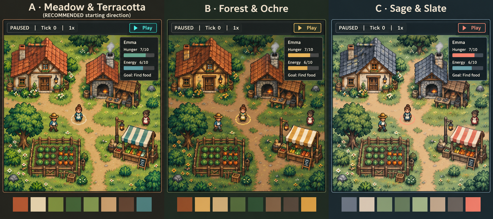

# TinyVillage pixel-art visual direction

**Status:** Draft for written review. The user's pixel-art preference and 13
explicit selections are recorded with their alternatives in the single decision
file, [D019](../../decisions.md#d019--select-pixel-art-direction-for-728).
These choices permit a consolidated proposal; the complete written artifact,
specific assets/fonts and proposed implementation defaults await review.

## 1. Intent, references and scope

Make a warm, grounded village readable as an autonomous simulation: recognizable
villagers, understandable buildings and activities, and quiet panels that explain
real state. Preserve #724's shared headless/Pygame simulation, D014's expansive
vision, D015's final-product AI and [#727's journeys](2026-10-20-issue-727-ux-design.md).
The initial art set serves the bounded economic fixture; its tile size, actor
count and coverage cannot become engine limits or remove later product scope.

Research base: merged main `739186124b965980662b8a7ee7b26306d2554b5f` (#791).
The renderer currently loads a flat map image and draws primitive entity shapes;
the four checked-in PNGs include an 800×600 placeholder map and small test images.
They do not establish a production tile/animation/foreground-layer pipeline.
Fonts and panels exist, but production readability and licensing still need the
work below. Research was static source inspection, primary-source retrieval and
visual inspection of candidate sheets. No game, font-rendering, animation or
performance test was executed for this planning document.

### Palette comparison reviewed with the user

Use **A — Meadow & Terracotta** as the palette reference: welcoming greens,
warm timber/cream plaster, clay roofs, sandy paths and restrained teal accents.
B Forest & Ochre and C Sage & Slate remain comparison evidence, not additional
themes to implement. The concept was generated in this conversation with
`image_gen`; no external reference image was supplied. It is a design reference,
not a running screenshot, production spritesheet, approved wireframe, exact
32×32 tile sample or contrast measurement. Its path, SHA-256 and dimensions
are retained in the [research receipt](../../testing/evidence/issue-728-design-research.json).

The illustrative HUD bars and labels do not override real units: higher hunger
is worse, higher energy is better. Their eventual meaning must agree with
#724/#727, including unavailable/rejected/blocked states. The image's detailed
grass and ornament are a mood reference, not a requirement to reproduce visual
noise or every decorative object. Its scene geometry is not the scenario map.

## 2. World art, readability and motion

Use an **angled top-down view**, with building fronts/roofs and villagers' faces
visible, on a straightforward orthogonal map. This is not an isometric diamond
projection. Keep a common perspective, proportions and material treatment across
terrain, buildings, characters and props. Use **32×32 source ground tiles**;
characters can be taller/wider as appropriate and buildings span multiple tiles.
Ground footprints, visual bounds and authoritative simulation positions remain
distinct so a tall roof does not redefine navigation or interactions.

Provide an identifiable home, workshop and market for the accepted fixture.
Distinguish them through silhouette, entrances, recognizable props/signs and
inspection text rather than roof color alone. Keep routes, entrances and actor
silhouettes readable; reserve the highest local contrast/detail for activity and
interactive targets. Do not add water, weather, extra buildings or world rules
merely because a reference or candidate asset sheet contains them.

Villagers share proportions and reusable art templates with curated variation
in hair, clothes, accessories and silhouette. Complete precomposed sprite sheets
are acceptable; this choice does not require runtime paper-doll customization.
Names and inspector information remain available; neither identity nor status
depends only on color. Check adjacent villagers for distinguishability at the
actual display size, including varied skin tones against the chosen terrain.

### Selection, focus and occlusion

The selected villager gets a contrasting ground ring and a thin sprite outline,
with its name in the inspector. Use light/dark edging as well as the accent
color; teal alone on green grass is not sufficient evidence of legibility.
Keyboard focus, hover, selection and blocked/error states must be distinguishable
by shape/placement and text rather than reused indistinguishable rings.

Fade foreground art **locally** when it obscures the selected villager. This
requires separately usable roof/tree/foreground layers, not a promise that the
current flat map can already do it. Preserve enough building structure to read
its location. Keep the treatment stable during pause; reduced-motion mode uses
an immediate stable visibility treatment. Fade only presentation pixels; do not
change collision, pathfinding, time or entity state. #729 defines focus/selection
transitions and visibility of selected buildings in its wireframes.

Show small contextual activity/status icons above **the selected villager**.
Explanations and village-wide alerts remain in the HUD/history as #727 requires.
Give blocked status an explicit label and distinct shape, such as an exclamation
triangle; runtime failure has a different shape/label and stops advancement.
Neutral waiting, deliberately disabled capability and unavailable evidence are
not mislabeled as failure or success. Exact glyph artwork remains a reviewable
production asset; icons must describe actual recorded activity, not invented
motives or predicted success.

### Animation and scaling

Use short walk cycles, readable activity poses and a small amount of ambient
motion. Provide static pose/icon/text equivalents; movement alone cannot explain
an action. Action effects remain authoritative even when animation is paused,
omitted or slow. Use the simulation's real activity state, not animation end,
to claim success. No rich weather/lighting/particle system is required by this
initial art scope; such systems remain available to later roadmap work.

Decorative motion is reducible and must fit existing frame budgets. Pausing stops
world playback; inspection and essential controls remain responsive. Avoid
perpetual blinking or flashing status cues. Opacity transitions cannot make an
occluded selected actor inaccessible while paused or in reduced-motion mode.

Render world art at **whole-number scales** with a flexible viewport; a different
window may expose a different amount of the map. Preserve crisp nearest-neighbor
edges; do not disguise 16×16 source art as the chosen 32×32 art density simply
by enlarging it. HUD text is sized independently and can use normal readable
font rendering. This sets a rendering constraint, not a camera-zoom feature.
Validate 1280×720 and 1024×768 with no clipped essential controls; #729 owns
layout, scrolling, focus and resize behavior.

## 3. HUD, typography and proposed design tokens

Use restrained pixel-art frames with quiet opaque/high-contrast panel backgrounds,
thin borders and limited decoration. Place text on a stable panel surface rather
than noisy map art, wood grain or parchment texture. Emphasize selected entity,
current goal/action/outcome and playback status ahead of decorative detail.
Do not collapse Finished, Paused, Saving/Loading, blocked activity and Recovering
into one ambiguous state. #729 specifies panel structure and interaction states.

Information, controls, explanations and numbers use readable conventional text.
Pixel lettering is reserved for short headings/decorative labels where legible.
Evaluate font candidates below using actual names, punctuation and numerical
pairs (`0/O`, `1/I/l`, minus signs, decimals and `×`). Declared character subsets
are not glyph-rendering evidence. Provide a tested coverage/fallback strategy
before claiming support for scripts or names outside the selected files.

The following exact values are **proposals for written review**, not values
already selected from the conceptual image. They give #729 a reproducible
starting point; do not sample arbitrary image pixels and call them approved.

| Role | Proposed value / behavior |
| --- | --- |
| World family | Meadow `#6B8E45`, deep foliage `#3F6038`, clay `#B9633F`, plaster `#D9C89E`, timber `#79543B`, path `#BFA174`; material ramps may extend coherently. |
| Quiet UI | Panel `#202927`, inset `#29342F`, main text `#F3EAD5`, secondary text `#C9C9B5`. |
| Active/selected accents | Teal `#64D6C4`; dark control lettering/marker edge `#17211C`; a light edge is also available for the ring/outline. |
| Blocked / runtime failure | Amber `#E5BC68` / coral `#F09B87`, each paired with a distinct symbol and label. These are semantic accents, not full-screen color washes. |
| Type scale | Start trials at 18 logical pixels for body/control text, 16 for secondary information, 24 for short headings; wrap/scroll rather than shrinking essential text to fit. |
| Spacing/hierarchy | Start with a 4-pixel spacing grid, 8-pixel control padding, 12-pixel panel padding and 16-pixel group gaps; #729 checks density at both target sizes. |

Eight solid-color token comparisons were calculated using relative sRGB
luminance: body/panel **12.459:1**, secondary/inset **7.688:1**, teal/panel
**8.493:1**, dark text/teal **9.410:1**, amber/panel **8.328:1**, coral/panel
**6.921:1**, light marker/meadow **3.143:1**, dark marker/path **6.740:1**.
The receipt records exact inputs and thresholds. This validates these arithmetic
pairs only. Rendered texture, antialiasing, disabled controls, focus, occlusion
and every actual adjacent background still need native review. Preserve #724's
4.5:1 text and 3:1 essential-cue targets with non-color cues; do not infer full
accessibility compliance from the board or these numbers.

## 4. Asset and font shortlist, licensing and coverage

The selected sourcing strategy is a coherent **free, permissively licensed
foundation with original gap-filling**, preferring CC0 where suitable. Choose
one compatible terrain/building family rather than mixing every pack below.
No third-party art or font binary is imported by this draft. Candidate metadata,
source-page/file hashes and inspected image dimensions are retained in the
research receipt; downloaded research copies stay outside runtime assets.

| Candidate and primary source | Observed fit / terms | Recommendation and remaining checks |
| --- | --- | --- |
| [Slates, Ivan Voirol](https://opengameart.org/content/slates-32x32px-orthogonal-tileset-by-ivan-voirol) | Page lists CC-BY 4.0 and 32×32 orthogonal tiles. Inspected v2 sheet: 1792×736, with modular terrain/building/prop pieces. Author suggests 16×24 characters; the pack has no character set. | Preferred environment-family trial. Keep attribution/license link and disclose modifications; adapt palette/detail and prepare local-fade layers. Verify exact imported subset and fill workshop/market/action-specific gaps with matching original art. Not a production adoption decision. |
| [Outdoor 32×32 tileset, Buch](https://opengameart.org/content/outdoor-32x32-tileset) | Page lists CC0; inspected sheet is 640×288 with terrain/cliff pieces and a different palette. | Limited CC0 terrain alternative/reference, not a complete village family. Needs palette adaptation and considerably more matching building artwork. |
| [32×32 RPG Character Sprites, Eldiran](https://opengameart.org/content/32x32-rpg-character-sprites) | Page lists CC0; inspected 384×672 sheet. Author explicitly states only half the characters have an East/West walking frame. | Actor-template trial, not a complete animation solution. Check silhouette/proportions next to the chosen environment; curate/recolor suitable variants and draw missing walk/activity frames consistently. |
| [Atkinson Hyperlegible](https://github.com/google/fonts/tree/main/ofl/atkinsonhyperlegible) | Observed OFL.txt states SIL Open Font License 1.1; metadata lists static Regular/Italic/Bold/BoldItalic files. | Preferred information-font trial. Test actual Pygame metrics, distinctions, wrapping and intended character coverage at both resolutions. |
| [Noto Sans](https://github.com/google/fonts/tree/main/ofl/notosans) | Observed OFL.txt states SIL OFL 1.1; metadata lists variable width/weight files. | Conventional-font alternative when coverage or visual fit favors it. Test actual file support and coverage rather than claiming every script from the family name. |
| [Pixelify Sans](https://github.com/google/fonts/tree/main/ofl/pixelifysans) | Observed OFL.txt states SIL OFL 1.1; metadata lists a variable font and Latin/Latin-ext/Cyrillic subsets. | Short-heading trial only. Check the shipped file works in the actual renderer; retain a conventional heading fallback if small lettering is unclear. |

Other screened sources explain why “free” is not enough:

- [Kenney Tiny Town](https://kenney.nl/assets/tiny-town) and
  [Roguelike/RPG pack](https://kenney.nl/assets/roguelike-rpg-pack) list CC0 but
  **16×16 tiles**. They are possible stylistic references, not a silent substitute
  for this 32×32 source-art contract.
- [LPC base assets](https://opengameart.org/content/liberated-pixel-cup-lpc-base-assets-sprites-map-tiles)
  list CC-BY-SA 3.0/GPL 3.0 and author-specific credits/terms. Do not treat the
  whole collection as CC0 or assume one file's permissions cover every asset.
- [Cainos Pixel Art Top Down — Basic](https://cainos.itch.io/pixel-art-top-down-basic)
  is visually relevant at 32×32, but its published terms prohibit redistribution.
  Do not vendor its source files into this public repository under the selected
  permissive-source strategy without separate permission/verified applicable terms.

Before production import, record each file's title/author, exact source URL and
version, checksum, selected license and full required notices, attribution,
modifications and role. Preserve applicable font copyright/OFL notices and
reserved-name obligations for modified fonts. Bundle the required notices with
distributed game assets; test offline packaged access. A webpage observation
does not replace checking the exact files and terms at import. Keep generated
concept provenance separate from third-party and production-asset provenance.

The first coverage audit must account for ground/path tiles, the three building
roles, foreground layers, distinguishable villagers and directional walks,
meaningful activity poses, selected/status icons, panel frames and text styles.
List missing pieces explicitly and link each necessary production/remediation
task to an issue. Asset availability must not silently reduce accepted gameplay.

## 5. Design review, evidence and next handoff

At #730's design review and #765/#766's later native walkthrough, retain actual
source/spec/asset/lock revisions, target window size/display scaling and images
of representative normal, selected, paused, blocked, busy, failed and finished
states. Check character/building identity on grass/path/roof-edge backgrounds,
crowded entities, selection behind scenery, keyboard focus versus selection,
static/reduced-motion cues, long names/explanations, save dialogs and numerical
needs/transfer information. Review foreground fading while paused and at every
agreed playback speed. Missing art/evidence or an untested font is incomplete.

Respect #724's existing 30 FPS, p95 ≤40 ms/p99 ≤66.7 ms frame targets and
no active frame above 250 ms; its control/memory/startup budgets also remain.
Record actual timing samples under the prescribed workload before making a
performance claim. Cache/reuse asset surfaces where implementation warrants;
do not assume pixel art is automatically cheap or alter existing diagnostic
deadlines. Animated previews and dummy SDL checks do not replace native human
readability/controls review. No new benchmark or runtime API is introduced here.

| Owner | Required next artifact or evidence |
| --- | --- |
| #728 | Written review of this direction, references, shortlist and proposed defaults; keep open until an explicit disposition. |
| #729 / #381 | Wireframes and implementation-ready panel/focus/busy/error/resize specifications using the agreed direction and #727 journeys. |
| #730 | Distinct human UX/UI/visual approval before authorizing UI implementation. |
| #731 / #732 | Engineering-practices review and separate Phase 2 gate. |
| Later implementation and Phase 8 | Production asset/notice audit, real rendering/occlusion/animation, measured budgets and human interaction/accessibility evidence. |

For the complete written review, the following are **proposed defaults**, not
additional choices already confirmed in D019:

| Detail | Recommendation | Alternatives and consequence |
| --- | --- | --- |
| Specific production foundation | Trial Slates with matching original gap-filling, and audit one compatible actor family. | CC0-only terrain plus more original buildings; entirely original assets. Avoid automatic multi-pack mixing. |
| Exact colors | Trial the tokens in section 3 and adjust from measured real scenes. | Derive a fresh palette with the same A mood; commission an original constrained palette. These require another visual comparison. |
| Specific fonts | Trial Atkinson Hyperlegible for information, Pixelify Sans for short headings. | Noto Sans information text; conventional text for every heading if pixel lettering fails legibility. No font is imported/approved yet. |
| Density/spacing | Trial the listed type sizes and 4-pixel spacing grid. | An 8-pixel grid uses more space; larger proportional text needs different wrapping/scrolling. #729 validates both resolutions. |
| Animation/layer details | Keep a small coherent set; author foreground pieces needed for selected-actor fading and draw missing directional/activity poses. | A larger bespoke animation set raises asset/performance scope; reducing required visibility/activity evidence needs explicit rework rather than omission. Exact frame counts/opacities belong in the production plan. |

#791 is merged, while #727's issue and final written-review disposition remain
open at this research snapshot. The user explicitly requested this #728 design
walkthrough; preliminary consolidation does not auto-close that prerequisite.
Review and record the outstanding #727 disposition as part of the design
handoff. Approval of this document is separate from #730/#732 and from product
implementation. Keep subsequent human decisions in docs/decisions.md under D003.
