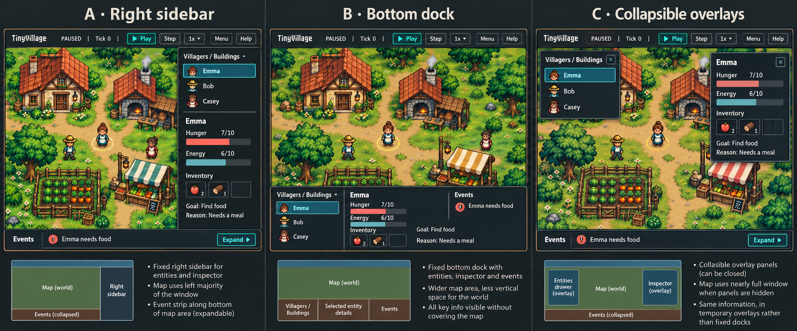

# TinyVillage Pygame interface, wireframes and interaction states

**Status:** Draft for written review. Twelve choices were explicitly selected
by dhar174; their authoritative record, alternatives and rationale are
[D020](../../decisions.md#d020--select-interface-behavior-for-729). Exact geometry,
input precedence and other connective defaults below are proposals for review,
not additional choices inferred from those answers. No UI implementation or
human design/phase approval is supplied by this document.

## 1. Intent and research boundary

Translate [#727's journeys](2026-10-20-issue-727-ux-design.md) and
[#728's pixel-art direction](2026-10-20-issue-728-visual-design.md) into a stable,
keyboard-operable observer interface. Keep the accepted #724 scenario, real
authoritative state, D014's expansive vision and D015's final-product AI.
Selection/rendering cannot choose or apply simulation actions. Direct character
commands and construction remain outside this observer design in #382.

Source base: merged main `4c9bbfd106d721a0b714990653edce8b01b4c041` (#792).
Inspected controller event dispatch, panel composition/rendering, shortcuts and
save/load paths, the map controller and existing design artifacts. Existing
panels stack at fixed positions; Escape still maps to quit, R regenerates
characters, L directly loads quicksave and persistence is incomplete. Those
paths are starting points, not evidence that these proposed states work.
Headless startup smoke still does not validate the economic episode.



The user chose **A — Right sidebar**. This generated board used #728's palette
reference; it compares placement only. Its inventory, text, bars, geometry and
artwork are illustrative, not scenario facts, final wireframes or a native
Pygame screenshot. In particular, icon inventories and hunger bars must never
override real quantities or #724's higher-hunger-is-worse meaning. Exact region
coordinates below supersede the board's approximate spacing. Reference hash,
source hashes and static bounds checks are retained in the
[design receipt](../../testing/evidence/issue-729-ui-design-checks.json).

## 2. Main-screen wireframes and information architecture

Keep a persistent top bar, map to the left, entity browser/inspector docked on
the right, and an expandable event/results drawer below the **map area**.
The sidebar remains visible when the drawer expands; neither covers villagers.
At 1024×768 retain this arrangement, narrowing the sidebar and using wrapping
and local scrolling. Do not switch to another layout or shrink essential text.

### Proposed dimensioned wireframes

Coordinates are `(x, y, width, height)` in logical screen pixels. These initial
dimensions are configurable layout values, not new hard-coded simulation limits.
Outer margin and inter-region gap are 8; top bar is 64 high, collapsed strip 40,
expanded drawer 240. Sidebar width interpolates from 280 at width 1024 to 304
at 1280, then clamps at those values for this initial supported range. Outside
the agreed support sizes, do not claim native support from these arithmetic
rules alone. Text metrics and display scaling still require actual validation.

| Region | 1280×720 | 1024×768 |
| --- | --- | --- |
| Top control/status bar | `(8,8,1264,64)` | `(8,8,1008,64)` |
| Right sidebar | `(968,80,304,632)` | `(736,80,280,680)` |
| Map, drawer collapsed | `(8,80,952,584)` | `(8,80,720,632)` |
| Compact event/outcome strip | `(8,672,952,40)` | `(8,720,720,40)` |
| Map, drawer expanded | `(8,80,952,384)` | `(8,80,720,432)` |
| Expanded Events/Summary drawer | `(8,472,952,240)` | `(8,520,720,240)` |
| Entity browser inside sidebar | `(980,92,280,160)` | `(748,92,256,160)` |
| Inspector inside sidebar | `(980,264,280,436)` | `(748,264,256,484)` |
| Centered Save/Load modal | `(280,100,720,520)` | `(152,124,720,520)` |

```text
Top bar: brand | state | tick | Play/Pause | Step | speed | population | Menu | Help
+------------------------------+---------------------+
| Map                          | Villagers/Buildings |
|                              | scrollable list     |
|                              +---------------------+
|                              | Selected overview   |
|                              | expandable details  |
+------------------------------+                     |
| Events strip or drawer       |                     |
+------------------------------+---------------------+
```

This schematic is not to scale; the table defines both collapsed/expanded cases.
Proposed header slot widths in order are 128/128/104/88/72/112/96/80/72,
with 8-pixel gaps/padding and 48-high controls. They occupy 960 pixels including
padding, within both top bars. Use a labelled speed selector for 0.5×/1×/2×/4×
and expose the actual current value. Scenario/seed/profile are available in
the session menu/Help; do not silently truncate values into misleading names.
Font fit is unmeasured: wrap/adjust grouping in a reviewed revision if actual
metrics fail, rather than hiding controls or claiming the bounds check proves it.

The paused session menu presents **Resume, Quicksave (S), Save… (named saves),
Load…, Restart…, Quit**, in that order. Each action has a visible label and is
focusable, with mouse and Enter/Space activation. Quicksave is distinct from
the named-save dialog: its menu control and S invoke the same command, dedicated
slot and enabled/busy/world-validity checks. While saving or when the world is
untrusted, both routes are disabled. Invoking Quicksave from the menu keeps the
menu open and playback paused, retains focus on the action, and reports the
actual result without opening a naming or overwrite dialog.

Maintain crisp integer world scaling and independent HUD text sizing. Map
clipping/hit testing use the same camera transform. Resizing preserves selected
entity identity and logical state; it changes visible area, not world coordinates
or decisions. Proposed camera behavior preserves the current world-view anchor
and clamps to world bounds; it does not add camera controls or auto-follow.

### Entity browser and inspectors

Use Villagers/Buildings tabs and one stable, scrollable entity list. A proposed
40-high tab row plus three 40-high rows fits the initial browser. More entities
scroll instead of pushing the inspector off-screen. Display names with stable
disambiguators where needed; movement never reorders rows or steals focus.
Map click selects the same entity as list Enter. Arrow movement changes list
focus; Enter commits selection. Clearing selection shows an instructional empty
inspector while keeping the list available.

The character inspector has a compact overview followed by expandable
**Inventory, Plan and Recent Memory** sections. Keep identity/state visible at
the top; scroll the body independently. The overview includes needs with units
and direction, credits, a short inventory summary, goal/current action, brief
reason and latest outcome. Details expose actual quantities, recorded plan/
precondition evidence and recent records. Technical reasoning remains expandable.
Refreshing live values does not reset expanded sections, focus or scroll position.

Building inspection uses the same dock for identity/purpose, location and real
stock/resources, with applicable read-only details and interaction availability/
reasons. Do not show a fabricated character Plan/Memory for a building or introduce
executable building commands. If a selected entity is removed or a world is
replaced, discard stale references and explain the cleared selection.

Keep unavailable capabilities visible with a reason and access to requirements.
For example, semantic recall disabled in basic mode does not disable recent
memory. Distinguish a real empty collection, loading, disabled, not initialized,
unavailable/failed, stale last-known data and not-applicable fields. Label unknown
values rather than inventing zeroes, successful outcomes or model reasoning.
Rendering an availability section must not initialize AI/model services.

### Events, confirmations and final results

The compact strip presents a meaningful latest event, Expand and an unread/new
count as needed. Expanded history is a non-modal, scrollable bottom drawer;
opening it leaves playback under explicit controls. Entries include tick,
actor/target, recorded reason and committed/rejected/blocked outcome; show real
changes, not implied success from an action name. While reading older entries,
hold reading position, accumulate a new-event count and offer Jump to Latest.

Routine confirmations appear briefly in a consistent HUD location and are
retained in history. Proposed location is the existing compact strip/status
lane rather than a map-covering toast; hold the confirmation long enough to
read while retaining incoming events in history. Do not steal focus. Failed
saves and other actionable errors have persistent text/actions; blocked goals
retain inspector/history indicators while other villagers continue. Notification
severity and selection/focus use distinct shapes/labels as well as color.

At the final tick switch the header to **Finished**, disable Play/Step and
show the persistent non-modal **Summary** in the bottom drawer alongside Events.
Keep goals/outcome, invariant checks, transfers/consumption and report-write
status inspectable; a failed write cannot look like successful publication.
When collapsed, keep the compact outcome visible. Inspection, events, named
save where state is trusted, Load, Restart and Quit remain available; playback
cannot extend the bounded episode.

## 3. State and session-operation specification

Playback, selection, drawer, modal, operation and capability status are separate
concerns. Selecting a villager is not a playback state change, and an unavailable
semantic feature is not a failed world. These are conceptual state requirements,
not a mandated runtime class, enum or wire schema.

| State / event | Presentation and allowed transitions |
| --- | --- |
| Ready, no selection | Paused at tick 0; list and launch hint visible; inspector explains selection; Play/Step available. |
| Selected while Running or Paused | Ring/outline plus actual entity details; selecting, expanding sections or reading history never changes playback. |
| Running | Header shows Running; Play becomes Pause; Step unavailable with a visible explanation. Speed changes pacing only. |
| Explicitly Paused | Header shows Paused; UI/selection remain responsive; Step advances exactly one complete tick and remains paused. |
| Menu / ordinary modal open | World paused; only active dialog can receive modal input; close/Cancel leaves paused until Play/Resume. |
| Saving | Hold a complete world tick; show Saving/busy and operation target. Keep inspection/history/Help responsive; disable Play/Pause, speed and duplicate Save/Load/Restart/Step requests until the safe boundary. Never signal success before durable completion. |
| Loading / validating | Stay paused; identify source save and validation progress. Keep the live world until the complete replacement is valid. Commit once; replace stale entity/view references. |
| Successful Load | Restored world is non-advancing and identified by save/tick; unfinished episodes require explicit Play. Proposed terminal-save rule preserves Finished and disabled Play/Step rather than relabeling it resumable. |
| Save/Load failure, world still valid | Persistent operation error and next actions; keep typed name/selection where possible. Failed writes preserve the old save; invalid loads preserve the live world. No successful transition is inferred. |
| Unsaved transition | Save and Continue / Discard and Continue / Cancel. Track the requested Load/Restart/Quit; complete it only after successful requested save or explicit discard. Cancel preserves the live world. If state is untrusted, Save and Continue is unavailable with its safety reason; Cancel returns to recovery, not playback. |
| Ordinary blocked goal | Persistent, explained blocked state; other villagers continue; no fake replenishment, recovery or completion. |
| Runtime/invariant failure | Stop advancement; show Recovering/failure notice and diagnostic reference. Disable Play/Step and ordinary Save of untrusted state; offer only safe recovery operations. |
| Finished | Non-modal Summary/Events, compact outcome and read-only world inspection; no further ticks. |

### Save/Load dialogs, transitions and failure safety

Use a centered modal at either resolution, with title, a focused save list,
scenario/tick/save-time metadata, naming controls for Save, visible error space,
primary action and Cancel. Proposed inner regions use 16-pixel margins, a
40-high title, body at y+72 with height 360, and a footer at y+448 with height
56. The footer/title stay visible while the body scrolls. No external file
browser or new save format is required by this UI decision.

Named-save replacement requires confirmation. Menu → Quicksave (S) and the S
shortcut write the dedicated quicksave slot without an overwrite prompt and
give the actual result. Every operation uses complete authoritative state
through the later persistence implementation; the existing partial save/load
methods do not meet this contract.

The selected policy holds simulation advancement at a complete tick during
saving while input/rendering stay responsive. This is a consistency policy, not
permission to block the event loop with file I/O. Load validates before world
replacement. Never permit duplicate commits from repeated keys or button clicks.
The UI must preserve old valid data when writing fails.

**Proposed quicksave return policy:** for S invoked outside the session menu,
capture whether the valid world was running or paused and restore that state
after its temporary save hold. A save I/O error alone does not imply world
corruption; show a persistent error and preserve that same prior state when safe.
A concurrent runtime/invariant failure overrides this and stays stopped. This recommendation
was discussed alongside the save choice, but not independently selected; it
requires written review. Menu Quicksave and named saves/loads remain paused;
failed Save and Continue never completes the pending destructive transition.

Ordinary dialogs can cancel before commit. During a non-cancellable save/load
commit, keep visible busy status and explain unavailable dismissal; keep pumping
input/window events. Do not silently discard an in-flight transaction or queue
world mutations. Proposed window-close handling defers an exit request until
the safe operation boundary, then applies the same unsaved guard; a process-level
forced termination remains incomplete failure evidence, not successful Quit.

Recovery shows what failed, the last validated tick/evidence reference and safe
Load/Restart/Export Diagnostics/Quit actions as applicable. Retry is visible only
for a known repeatable safe operation. Untrusted live fields are not displayed
as current valid data; use labelled last-known state or unavailable values.
Recovery cannot be dismissed into unsafe playback, and export failure has its
own visible result. Headless failures remain console/result/exit behavior from
#724/#727; this design adds no dialog or renderer requirement to headless use.

## 4. Input ownership, focus and inclusive interaction

Every essential operation has a visible labelled control reachable by Tab and
Enter/Space. Focus, selection, hover, disabled and error states are distinct.
Buttons do not depend on hover-only text or color-only severity. Reuse #728's
proposed readable type/contrast tokens subject to native review; world pixel
scaling does not force tiny HUD text. Reduced motion removes decorative
transitions while preserving immediate selected-actor visibility and static
activity/status cues. No flash or animation is required to understand state.

| Input | Meaning in its valid context |
| --- | --- |
| Space | Toggle playback when map/global playback context owns input; a focused control uses Space for its own activation. |
| `.` | One tick only when unfinished, paused and no modal/operation owns input. |
| Page Up / Page Down | Next faster/slower preset, clamped to 0.5×/1×/2×/4×. Proposed focus rule lets a focused scrolling view page locally first. |
| S | Quicksave; matches visible Menu → Quicksave (S), with no naming/overwrite modal for its dedicated slot. |
| L | Open Load selection/validation flow, never directly load a hard-coded file. |
| R | Request identical-scenario Restart through the unsaved guard, never regenerate random characters. |
| H / F1 | Visible in-window Help with actual controls, mode/capability context and guidance. |
| Arrows / Enter | Navigate/select within the focused entity list; do not issue character movement commands. |
| Tab / Shift+Tab | Move through visible logical focus order; active modal contains traversal. |
| Escape | Consume exactly one dismiss/menu action according to the order below; never directly Quit. |

Proposed main traversal is top controls left-to-right, entity tabs/list, inspector
headers/expanded controls, event strip/drawer, then the map focus target. A list
is one Tab stop with roving row focus, not hundreds of stops. Header identity is
retained while inspector content scrolls. New events/live values never steal
focus. Rebuild focus safely by stable identity after removal, resize or load.

Input ownership is **text composition/editing → active modal/popover → focused
widget → global shortcut → map hit testing**. A consumed event cannot also
reach the map/global action. S/L/R/`.` typed into a save name never cause an
operation. Widget arrows/Enter/Space act locally. Proposed Page Up/Down precedence
lets scrollable lists/history use paging while focused; speed controls remain
visible and focused/map context can use the agreed shortcut. This focus detail
is a written-review proposal, not a change silently attributed to D020.

Mapped shortcuts share the visible control's enabled predicate. During a
non-cancellable commit, consume unavailable playback/session shortcuts without
queuing them for later execution, and keep the busy explanation accessible.

Proposed Escape order: composition cancels locally; close the top transient
popover; apply the active modal's safe Cancel/Close rule; dismiss the most
recently activated dismissible non-modal view; otherwise open the paused session
menu. Return focus to its invoker, or the nearest valid parent if it no longer
exists. A pending guard's Escape means Cancel, never Discard. A recovery or
non-cancellable commit does not fall through to another handler. Closing a
non-modal inspector clears selection while retaining the permanent entity list.
Only one layer is dismissed per press.

Proposed initial focus is the entity list on Load, name field on Save, Resume
if enabled on the session menu, and Cancel for destructive confirmations.
Enter on a focused field must not silently choose Discard/Overwrite. Failed
operations keep the affected control/value and expose the error next to it.
Load-list Enter selects a row; replacement starts through the explicit Load
action. Recovery initially focuses the first safe enabled operation, or Quit
when no other operation is available; it has no unsafe generic Resume/Cancel.
Mouse wheel scrolls the region under the pointer; an unhandled event alone
can reach the map. Repeated keydown while held must not enqueue multiple saves,
restarts or discrete Steps. These details remain part of written review.

## 5. Validation, outstanding proposals and handoff

### Evidence required later

The reference was copied unchanged and 18 region rectangles/18 header slots were
checked for bounds at the two supported sizes. Collapsed and expanded main
regions are pairwise non-overlapping; browser/inspector stay inside the sidebar.
This is arithmetic evidence, not rendered font fit, usability or performance.
No game, renderer, package installation or runtime test was run for this draft.

After implementation, exercise these cases at **both** resolutions, with mouse
and keyboard and normal/reduced motion. Retain source/spec/asset/lock revisions,
actual screenshots, state/event traces, focus observations and timing evidence:

- Launch paused with no selection; select each entity type, inspect live/paused,
  expand every section and read long/wrapped names/reasons without clipping.
- Expand/collapse Events without pausing, read older records while new events
  arrive, Jump to Latest and inspect the same villager after resizing.
- Verify empty/disabled/not-initialized/unavailable/failed/last-known values
  against real capabilities without model initialization or fabricated records.
- Run all shortcuts with map focus, list/history focus, text input, each modal,
  a pending guard and an in-flight operation. Verify one consumed action per key.
- Invoke Menu → Quicksave (S) using mouse and Tab/Enter without using the
  shortcut. Compare with S: same dedicated slot, command and state checks;
  saving/untrusted state disables both. Menu invocation retains menu focus and
  paused playback on success or save I/O failure, with the actual result visible.
- Create/overwrite/cancel named saves and quicksave; show busy/success/failure;
  exercise all guard branches and a failed requested Save and Continue.
- Reject corrupt/incompatible saves without world mutation; load valid state
  non-advancing; compare actual continuation with uninterrupted execution.
- Induce safe runtime failure and diagnostic-export failure; verify only safe
  actions and no ordinary save/resume of untrusted state.
- Finish the bounded episode with honest outcomes/report status; inspect and
  switch Summary/Events, collapse it, and verify Play/Step cannot extend ticks.
- Verify text/non-color cues, keyboard focus, local occluder fading and reduced
  motion against #727/#728 and #724's actual measurement workloads.

Keep #724's existing targets: control feedback p95 ≤100 ms/max 250 ms; save/load
≤2 s with acknowledgment ≤250 ms; confirmed Quit/cancel cleanup ≤2 s; 30 FPS
with frame p95 ≤40 ms/p99 ≤66.7 ms and no active frame above 250 ms. User time
reading a guard is not shutdown execution time. Preserve all other accepted
startup/simulation/memory budgets and diagnostic deadlines. Dummy SDL and
passing CI do not replace human native-display evidence or approve #730.

### Additional defaults needing written review

| Detail | Recommendation in this draft | Alternatives / tradeoff |
| --- | --- | --- |
| Exact dimensions | Use the region/header table and bounded 240-high drawer as the initial wireframe. | Wider inspector or taller drawer improves details at a cost to map area; requires revised bounds and real font checks. |
| Temporary quicksave hold | Return to prior playback only if world validity permits; menu operations remain paused. | Always leave paused after S; prompt to resume. These add explicit interaction after routine quicksave. |
| Focus and Page Up/Down | Focused-widget paging wins; globals consume only unhandled input; use the documented traversal/Escape order. | Global speed keys outside text override paging; or revise speed shortcuts. Either needs another focused review. |
| Routine confirmation | Show for five seconds in the existing HUD strip/status lane, retain history and focus. Do not auto-dismiss actionable errors. | A longer configurable duration; a separate toast lane that reserves space. Neither should cover villagers or lose evidence. |
| History display | Start with 200 recent UI entries and a labelled count/route to the complete canonical result trace. Never trim the canonical evidence. | Paginated history increases navigation; a larger buffer uses more memory. Exact trace availability must be reported honestly. |
| Terminal saves / window close | Preserve Finished when loading a terminal world; defer a requested close during non-cancellable commit to its safe boundary. | Showing Paused with explicit terminal explanation is more ambiguous; rejecting terminal saves narrows persistence scope. Immediate forced termination cannot claim successful save/Quit. |

These are not additional confirmed decisions. The existing #727 walkthrough
method, #728 production assets/fonts/tokens and remaining defaults still need
their written dispositions. #791/#792 are merged, while #727/#728 remain open
at this snapshot. The user explicitly requested this preliminary #729 review;
no prerequisite closure or human approval is inferred from merged documents.

| Owner | Handoff |
| --- | --- |
| #729 | Review this written interface/state specification and defaults; keep open until an explicit disposition. |
| #730 | Distinct combined UX/UI/aesthetic review of #727–#729 and any required rework before UI implementation authorization. |
| #731 / #732 | Engineering-practices review and separate Phase 2 decision gate. |
| #381 / later UI work | Implement the reviewed read-only HUD/inspectors/input ownership using real state; production art and renderer boundaries remain explicit. |
| #755–#758 | Complete versioned atomic persistence, pending transitions/continuation and human recovery evidence. |
| #658 / Phase 8 | Canonical episode/report integration and real human interaction/accessibility/release evidence. |

This draft introduces no runtime API/schema, new dependency, lock, workflow,
production asset or support claim. Record subsequent human dispositions only
in docs/decisions.md under D003; do not use a PR merge or elapsed time as a phase
approval. After written planning acceptance, #730 is the next ordered review.
